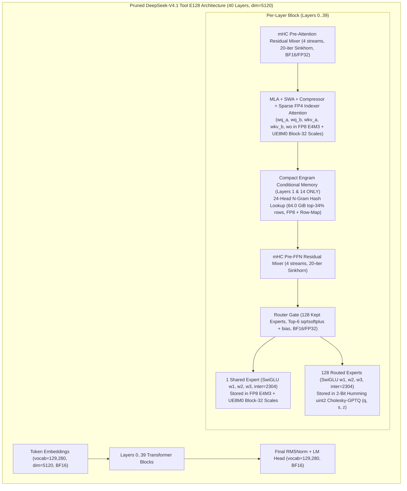

# Pruned DeepSeek-V4.1 (`Tool E128` 2-Bit) SFT & QAT: Architecture, Quantization, Training & Evaluation Reference

**Last Updated:** 2026-10-31  
**Scope:** End-to-end technical guide and experimental reference for loading, evaluating (Havu's Candidate B32 harness, both `json` text and E058 `text+image`), and fine-tuning (MoE-only SFT & Multimodal Quantization-Aware Training / QAT) the pruned + 2-bit quantized **DeepSeek-V4.1-Flash-1017 (`Tool E128` 2-bit & Image `E128` 2-bit)** models on **ARC-AGI-2**.
- **For the full Round-2 Multimodal (`Text + Image`) QAT SFT (`v14`) & Candidate B32 Evaluation report**, see **[`dsv41_qat_image_v14_experiment_report.md`](dsv41_qat_image_v14_experiment_report.md)**.

---

## 1. Executive Summary & Latest ARC-AGI-2 Evaluation Results

We built a complete, dependency-clean PyTorch `8×B200` / `16×B200` (`DP=2 × EP=8`) training, 2-bit/FP8 export, and multi-shard Candidate B32 evaluation pipeline for collaborator Havu's (`chankhavu`) pruned **DeepSeek-V4.1-Flash-1017 (`Tool E128` 2-bit & Image `E128` 2-bit)** models (`40` layers, `128` kept routed experts/layer in 2-bit Humming `uint2` GPTQ + `FP8` block-32 backbone + `64 GiB` Compact Engram on layers 1 & 14 + ViT/aligner vision tower).

### 1.1 Round-2 Multimodal (`Text + Image`) QAT SFT (`round2_v14_16xb200_fast` on `16×B200`)
- **Base Model:** `/cns/lu-d/home/arazdai/kaggle/models/dsv41_img_e128_2bit_causal` (`vision_enabled=True`).
- **Dataset (`e065_img_text_v1`):** `6,149` verified E065 trajectories (`3,050` multimodal `text+image` + `3,099` `json` text; `79.69M` tokens, `22,778` PNG images, `0` identifier/syntax errors, `WIC-alnum = 10.0×` loss weight).
- **True QAT Breakthrough:** By training all **`1,887,436,800` per-group 2-bit scales (`qat_scale`)** in `FP32` alongside `r=32` LoRA and the vision aligner (`--train_vision=aligner`) under STE fake-quantization, **`80.21% -> 86.33%` (`1.63B / 1.89B`) of all routed-expert group scales updated in the exported 2-bit checkpoints** (solving `v12`'s `0.00%` 2-bit dead-zone).
- **Uploaded HuggingFace Checkpoints:**
  - **[`chankhavu/ds-qat-image-v02-ep08`](https://huggingface.co/chankhavu/ds-qat-image-v02-ep08)** (`step-00154-epoch_0p80` resumable QAT delta; standalone 2-bit export at `.../round2_v14_16xb200_fast/wu_1/export_2bit/epoch_0p80`).
  - **[`chankhavu/ds-qat-image-v02-ep1-2bit`](https://huggingface.co/chankhavu/ds-qat-image-v02-ep1-2bit)** (`export_2bit/epoch_1p00` standalone 2-bit Humming + FP8 block-32 + Vision checkpoint).

| Milestone (`v14` QAT Image) | Step (`Epoch`) | Held-Out `val_loss` (`val_ppl`) | Held-Out `val_wic_alnum_loss` | Routed Scales Changed (`1.887B`) | **Apples-to-Apples E058 `text+image` Score vs. Base Image Model** | Tool-Call Error Rate (`Auto-Repairs`) | Mean (Median) Tokens / Attempt |
| :--- | :---: | :---: | :---: | :---: | :---: | :---: | :---: |
| **Base Image (`dsv41_img_e128_2bit_causal`)** | `0` (`0.00`) | `0.71123` (`2.0365`) | `0.22521` | `0.00%` | `76.11%` (`86.00/113` Attempt-0 tasks) | `15.8%` (**`101` repairs**) | `32,126` (`28,392`) |
| **`epoch_0p20`** | `39` (`0.20`) | `0.68380` (`1.9814`) | `0.12589` (`-44.1%`) | `80.21%` | `65.06%` Pass@1 / **`74.71%` Pass@2** (`114` tasks, `N=2`) | `10.1%` (`6` repairs) | `26,336` (`22,520`) |
| **`epoch_0p40`** | `77` (`0.40`) | `0.67712` (`1.9682`) | `0.12378` (`-45.0%`) | `84.38%` | `68.91%` Pass@1 / **`79.27%` Pass@2** (`119` tasks, `N=2`) | `8.8%` (`15` repairs) | `27,828` (`24,992`) |
| **`epoch_0p60`** | `116` (`0.60`) | `0.67388` (`1.9618`) | `0.11992` (`-46.8%`) | `85.80%` | **`79.00%` vs Base `75.97%` (`+3.03 pp`, `77` common tasks)** *(Shard 3 Pass@2: **`80.86%`**)* | **`7.4%` (`4` repairs)** | **`28,737` (`-15.4%`)** |
| **`epoch_0p80` ★ (`ds-qat-image-v02-ep08`)** | `154` (`0.80`) | `0.67257` (`1.9593`) | `0.12105` (`-46.3%`) | **`86.22%`** | **`87.76%` vs Base `80.61%` (`+7.14 pp`, `49` common tasks)** | **`9.0%` (`2` repairs)** | **`21,469` (`17,385`, `-21.5%`)** |
| **`epoch_1p00` ★ (`ds-qat-image-v02-ep1-2bit`)** | `193` (`1.00`) | **`0.67152` (`1.9572`)** | **`0.11979` (`-46.8%`)** | **`86.33%`** | **`86.54%` vs Base `82.69%` (`+3.85 pp`, `52` common tasks)** | **`6.4%` (`1` repair)** | **`18,975` (`16,910`, `-27.6%`)** |

---

### 1.2 Round-1 Text-Only MoE SFT (`v12`) — Completed 120-Task Results (`8×B200`)
- **Run XIDs:** [`http://xid/305920165`](http://xid/305920165) (steps 1–57) $\to$ auto-resumed in [`http://xid/306004894`](http://xid/306004894) (steps 49–114, `COMPLETED / SUCCESS`).

| Checkpoint (`v12` Text-Only B32) | Tasks Done | Held-Out `val_loss` (`WIC-Alnum`) | **Official Kaggle Pass@1 (`120` Tasks)** | **Official Kaggle Pass@2 (`120` Tasks)** | Demo-Verified Pairs (`train_pass`) | Output Tokens (Median / Mean) |
| :--- | :---: | :---: | :---: | :---: | :---: | :---: |
| **Base (`dsv41_e128_2bit`)** | **`120 / 120`** | `0.6768` (`0.2155`) | **`71.94%`** (`86.33/120`) | **`80.28%`** (`96.33/120`) | `146 / 167` (`87.4%`) | `36,506` / `39,410` |
| **SFT `epoch_0p25` (Step 28) ★** | **`120 / 120`** | `0.6656` (`0.1456`, `-32.4%`) | **`80.69%` (`96.83/120`, `+8.75 pp`)** | **`84.31%` (`101.17/120`, `+4.03 pp`)** | **`153 / 167` (`91.6%`)** | **`33,212` / `35,840`** |
| **SFT `epoch_0p50` (Step 57)** | **`120 / 120`** | `0.6649` (`0.1407`, `-34.7%`) | `75.69%` (`90.83/120`, `+3.75 pp`) | `81.53%` (`97.83/120`, `+1.25 pp`) | `149 / 167` (`89.2%`) | `34,649` / `37,104` |
| **SFT `epoch_0p75` (Step 85) ★** | **`120 / 120`** | **`0.6606` (`0.1389`, `-35.5%`)** | `77.36%` (`92.83/120`, `+5.42 pp`) | **`85.28%` (`102.33/120`, `+5.00 pp`)** | **`153 / 167` (`91.6%`)** | `34,071` / `36,712` |

---

## 2. Architecture of Pruned DeepSeek-V4.1 (`Tool E128` 2-Bit)

The base model is `DeepSeek-V4.1-Flash-1017` (`revision 1bae0e10`), pruned and quantized by Havu (`E043`) into `chankhavu/DeepSeek-V4.1-Flash-1017-arc-tool-E128-2bit` (`131.1 GB` total on disk, stored on CNS at `/cns/lu-d/home/arazdai/kaggle/models/dsv41_e128_2bit`):

### Component Breakdown
1. **Backbone Dimensions (`config.json`)**:
   - `n_layers = 40`, `dim = 5120`, `vocab_size = 129,280`, `max_seq_len = 163,840`.
   - **Attention (`MLA` + `SWA` + `Compressor` + `Indexer`)**: `n_heads = 128`, `q_lora_rank = 1536`, `kv_lora_rank = 512`, `qk_nope_head_dim = 128`, `qk_rope_head_dim = 64`, `v_head_dim = 128`, interleaved with 7 Sliding-Window Attention (`SWA`) groups, a KV token compressor, and a dynamic sparse-attention indexer (`index_n_heads = 32`, `index_head_dim = 128`, `index_topk = 2048`).
   - **Multi-Head Hyper-Connections (`mHC`)**: 4-stream residual highway (`mhc_n_streams = 4`) using 20-iteration Sinkhorn doubly-stochastic matrix normalization (`mhc_sinkhorn_iters = 20`) around every attention and FFN sub-layer.
2. **One-Shot Tool-Protected Expert Pruning (`384 -> 128` Routed Experts/Layer)**:
   - Full `DeepSeek-V4.1-Flash-1017` has `384` routed experts per layer (`top-6` selection), which takes `289 GB` in MXFP4 and cannot fit on `4×L4` (`96 GiB` total VRAM).
   - Because DeepSeek-V4.1 has high routing entropy (`~121.7` effective experts/layer in tool mode), keeping **128 experts in 2-bit** (`87.5%` routing traffic covered, `72.8%–76.5%` Pass@1) dramatically outperforms keeping 72 experts in 4-bit (`29.3%` Pass@1).
   - **Tool-Call Upweighting (`w = 10`)**: Standard output-norm pruning drops rare experts specialized for closing `<｜DSML｜function_calls>` tags. Havu scored experts over 10.04M calibration tokens with a $10\times$ weight on tool-call blocks (`keep_contrib_dec_sp0_w10_e128.npy`), retaining `>95%` of tool-call contribution and renumbering the kept 128 experts `0..127` (with `ffn.gate.{weight,bias,bias_vl}` sliced to 128 rows).
3. **Lossless Compact Engram Pruning (`188.8 GiB -> 64.0 GiB`, Layers 1 & 14)**:
   - Layers `1` and `14` contain an N-gram hash lookup memory (`384M` rows $\times$ `1280` cols, 24 prime-modulo hash heads over 2/3/4-grams).
   - Auditing 10,001 ARC tool rollouts (`251.8M` tokens) showed that keeping the **top 34% most frequent rows** (`64.0 GiB` total in `model-engram-*.safetensors`) plus an `int32 [384M]` `row_map` tensor covers **`97.6%`** of calibration lookups and **`94.0%`** of held-out eval lookups with `+0.0003` NLL difference.
   - In our 8×B200 engine (`dsv41_sft_model.py`), the 24 Engram hash heads are sharded across the 8 GPUs (**3 heads = 6 slices per rank**, `~8.6 GiB/GPU`) and combined via `dist.all_reduce`.

---

## 3. How Quantization Works in `dsv41_sft_model.py`

A 2-bit checkpoint directory (both base `dsv41_e128_2bit` and our exported `export_2bit/epoch_*` milestones) consists of two distinct quantization formats:

### 3.1 Backbone & Shared Experts: `FP8 E4M3` + `UE8M0` Power-of-Two Block-32 Scales (`model-0000{1,2}-of-00002.safetensors`)
All dense attention projections (`wq_a`, `wq_b`, `wkv_a`, `wkv_b`, `wo`, `wc`), KV compressor weights, and the **shared expert** projections (`layers.{0..39}.ffn.shared_experts.{w1,w2,w3}.weight`) are stored in **MXFP8 / Block-32 FP8**:
- **Weight tensor (`.weight`)**: `torch.float8_e4m3fn` of shape `[N, K]` (range $\pm 448.0$).
- **Scale tensor (`.scale` / `.weight_scale_inv`)**: `torch.uint8` in **`UE8M0`** format (unsigned 8-bit IEEE-754 exponent with zero mantissa bits, where byte value $u \in [0, 254]$ represents the exact power of two $2^{u - 127}$).
- **1D vs. 2D Scale Layouts**:
  - **1D block-32 scale**: shape `[N, K // 32]` (one power-of-two scale per 32 contiguous input channels).
  - **2D block-32 scale**: shape `[N // 32, K // 32]` (used by several backbone/shared-expert tensors; one power-of-two scale per $32 \times 32$ weight tile).
- **Exact Dequantization (`dequantize_fp8_block32_torch`)**:
  $$W_{\text{bf16}}[i, j] = \text{ float8\_e4m3fn}(W_q[i, j]) \times 2^{\text{int32}(\text{scale}) - 127}$$
  Because `float8_e4m3fn` has a 3-bit mantissa and `bfloat16` has a 7-bit mantissa with the same 8-bit exponent range, **decoding MXFP8 to BF16 is mathematically lossless (zero rounding error)**.
- **Quantization at Export (`quantize_fp8_block32_torch`)**:
  For each 32-element (or $32\times 32$) block, we compute $\text{amax} = \max |W|$ and take the smallest power-of-two scale $2^{e - 127} \ge \text{amax} / 448.0$ via bit-level IEEE-754 exponent ceiling (`exp_ceil`), then round $W / 2^{e - 127}$ to `float8_e4m3fn`.
- **Cross-Shard Scale Bug & Fix (`layers.9.ffn.shared_experts`)**:
  In `chankhavu`'s base checkpoint, `model-00001-of-00002.safetensors` and `model-00002-of-00002.safetensors` split inside Layer 9 such that `layers.9.ffn.shared_experts.w{1,2,3}.weight` are stored at the end of Shard 1, while their `.scale` tensors (`layers.9.ffn.shared_experts.w{1,2,3}.scale`) are stored at the beginning of Shard 2! Early SFT versions (`v4–v9`) looked up `.scale` only within the same shard, causing Layer 9 shared experts to load unscaled ($128\times$ too large, `step-0 val_loss = 16.4`, gibberish output). `load_dequantized_dsv41_e128` and `export_dsv41_e128_2bit_checkpoint` now build a unified cross-shard scale index across both shards and assert `fp8_dequantized_tensors == 330`.

### 3.2 Routed Experts: 2-Bit Humming `uint2` Asymmetric Cholesky-GPTQ (`gptq/layer_00..39.safetensors`)
Each layer file `gptq/layer_{L:02d}.safetensors` contains `128 × 3 × 3 = 1,152` tensors (`e{0..127}.{w1,w2,w3}.{q,s,z}`):
- **Dimensions & Group Sizes**:
  - `w1` (`gate_proj`, `[2304, 5120]`) and `w3` (`up_proj`, `[2304, 5120]`): **group size $G = 128$** along $K$ (`40` groups per row).
  - `w2` (`down_proj`, `[5120, 2304]`): **group size $G = 64$** along $K$ (`36` groups per row).
- **Packed Tensor Layout**:
  1. `q` (`int32 [N, K // 16]`): 16 unsigned 2-bit integer codes $q \in \{0, 1, 2, 3\}$ packed **LSB-first along input dimension $K$**:
     $$\text{packed\_q}[n, m] = \sum_{b=0}^{15} \big(q[n, 16m + b] \ \& \ 3\big) \ll (2b)$$
  2. `s` (`bfloat16 [N, K // G]`): Per-group continuous scale factor in `bfloat16`.
  3. `z` (`int32 [N // 16, K // G]`): 16 unsigned 2-bit zero-points $z \in \{0, 1, 2, 3\}$ packed **LSB-first along output dimension $N$** (transposed before packing in Humming's W2A16 layout).
- **Exact Dequantization (`dequantize_uint2_humming_expert_tensor`)**:
  $$W[n, k] = \Big(\underbrace{q[n, k]}_{\in \{0,1,2,3\}} - \underbrace{z[n, \lfloor k/G \rfloor]}_{\in \{0,1,2,3\}}\Big) \times s[n, \lfloor k/G \rfloor]$$

---

## 4. How We Implemented SFT & QAT on Pruned DeepSeek

### 4.1 What We Froze vs. What We Trained (`train_moe_only=True`)

When fine-tuning a heavily pruned MoE model (`128` of `384` experts kept per layer) on 3,642 reasoning trajectories, **freezing the routing and attention backbone is critical**:
- If the 128-way router gates (`ffn.gate`) or pre-router attention projections drift during SFT, tokens are routed to different experts than those calibrated during Havu's `E043` pruning and GPTQ Hessian collection, causing severe accuracy collapse.

| Module Group | Precision on Disk | Precision in Training (`v12 SFT` / `QAT`) | Status (`train_moe_only=True`) | Parameter Count |
| :--- | :---: | :---: | :---: | ---: |
| **Token Embeddings (`embed_tokens`)** | `BF16` | `BF16` | ❄️ **Frozen** | `0.66B` |
| **Attention (`MLA` + `SWA` + `Compressor` + `Indexer`)** | `FP8` (block-32) + `BF16` | `BF16` | ❄️ **Frozen** | `2.38B` |
| **mHC Residual Stream Mixers (`4` streams)** | `BF16` / `FP32` | `BF16` / `FP32` | ❄️ **Frozen** | `0.01B` |
| **RMSNorms + Router Gates (`ffn.gate.{weight,bias}`)** | `BF16` / `FP32` | `BF16` / `FP32` | ❄️ **Frozen** | `0.03B` |
| **Compact Engram Tables (Layers 1 & 14, Sharded)** | `FP8` + `int32` map | `BF16` (sharded 6 slices/GPU) | ❄️ **Frozen** | `~8.6 GiB/GPU` (`64 GiB` total) |
| **LM Head (`head.weight`)** | `BF16` | `BF16` | ❄️ **Frozen** | `0.66B` |
| **Base 128 Routed Experts (`w1, w2, w3`)** | `uint2` (`q, s, z`) | `BF16` (`W_0`, sharded 16 experts/GPU) | ❄️ **Frozen Base** (`25.74B`/GPU) | `205.9B` global (`25.74B`/GPU) |
| **Shared Experts (`layers.0..39.ffn.shared_experts`)** | `FP8` (block-32) | **`BF16` (v12) / `FP32 + STE` (QAT)** | 🔥 **Trained Densely** (replicated) | **`1.416B`** |
| **Routed Expert Adapters (`LoRA r=32, α=64` or `QAT Scales s`)** | Merged into `uint2` at export | **`BF16` (v12) / `FP32 + STE` (QAT)** | 🔥 **Trained Sharded** (`16` experts/layer/GPU) | **`0.456B` / GPU** (`3.65B` global) |
| **Total Per GPU (`EP=8`)** | — | — | **`1.872B` Trainable / `29.48B` Frozen** | `31.35B` resident/GPU |

### 4.2 Why Standard BF16 SFT Hits a "2-Bit Dead Zone" vs. How QAT (`enable_qat=True`) Solves It

In [`dsv41_sft_model.py`](../deepseek_sft_qat/dsv41_sft_model.py), we implemented **two training modes** controlled by `--enable_qat` and `--qat_trainable_expert_scales`:

1. **Mode 1 — Standard Dequantized MoE-Only SFT (`--enable_qat=false`, used in `v12`):**
   - Unpacks 2-bit `(q, s, z)` into frozen `BF16` base weights $W_0 = (q_{\text{orig}} - z_{\text{orig}}) s_{\text{orig}}$, attaches `LoRALinear(r=32, alpha=64)` to all 128 routed experts, and trains `shared_experts` densely in `BF16`.
   - **What happens at 2-bit export:** To avoid destroying Havu's activation-weighted Cholesky-GPTQ Hessian compensation (which happens if you run a data-free min-max L2 grid search that flips zero-points $z$), the exporter preserves `(s_orig, z_orig)` and re-rounds $W_{\text{merged}} = W_0 + \Delta W_{\text{LoRA}}$ onto the original grid:
     $$q_{\text{new}} = \text{clamp}\Big(\text{round}\big(q_{\text{orig}} + \Delta W_{\text{LoRA}} / s_{\text{orig}}\big), 0, 3\Big)$$
   - **The 2-Bit Dead-Zone Effect:** Because the 2-bit step size $s_{\text{orig}} \approx 0.03$ has a half-step rounding threshold of $s_{\text{orig}} / 2 \approx 0.015$, whereas 1-epoch LoRA deltas at `lr=1e-5` have $|\Delta W_{\text{LoRA}}| \sim 10^{-4}$, **almost no 2-bit codes $q$ cross the $\pm 0.015$ threshold** during a short SFT run! Consequently, under `--enable_qat=false`, the exported model's gains come primarily from the **40 trained FP8 `shared_experts` layers** (where the FP8 step size is $\sim 6 \times 10^{-5}$, 250× finer than 2-bit).

2. **Mode 2 — True Quantization-Aware Training (`--enable_qat=true`, with `--qat_trainable_expert_scales=true` or LoRA STE):**
   - **FP32 Master Weights:** Keeps `shared_experts`, `lora_A / lora_B`, and/or per-group scale parameters `log_scale_delta` in **`torch.float32`** so small SFT updates (`lr=1e-5`) accumulate smoothly without `BF16` mantissa underflow ($\text{ULP} \approx 7.8 \times 10^{-4}$).
   - **Direct Group-Scale QAT (`--qat_trainable_expert_scales=true`)**: Keeps Havu's GPTQ integer offsets $d_{\text{orig}} = q_{\text{orig}} - z_{\text{orig}} \in \{-3, \dots, +3\}$ frozen and trains the continuous per-group scales $s = s_{\text{orig}} \cdot \exp(\Delta \log s)$ (`360M` parameters globally across `w1, w2, w3`). Every update to $s$ survives export into `bfloat16` `gptq/layer_XX.safetensors` with **zero re-packing loss** while 100% preserving GPTQ's intra-group Hessian structure.
   - **Straight-Through Estimator (STE) Fake-Quantization in `forward()`**:
     - `shared_experts` pass weights through `fake_quant_fp8_block32_ste(w)` on every forward step so the model sees `UE8M0` power-of-two block-scale jumps during training.
     - Routed experts pass $W_{\text{master}}$ through locked-`z_orig` 2-bit STE rounding $\widehat{W} = W_{\text{master}} + \text{stop\_grad}(W_{\text{deq}} - W_{\text{master}})$, plus dynamic activation fake-quantization (`fake_quant_act_fp8_block32` on `w1/w3` inputs and `fake_quant_act_mxfp4_block32` on `w2` inputs).
     - **Zero Export Discrepancy:** In QAT mode, the exported 2-bit/FP8 checkpoint is bit-for-bit identical to the quantized weights used in the training and validation forward passes (`val_loss == post-export loss`, verified in `sft_test.py`).
   - **Optional QAD Forward-KL Anchor (`--qat_kl_weight=0.1`)**: Runs a `torch.no_grad()` teacher forward pass with adapters disabled (`model.disable_adapters()`) and blends $0.9 \cdot \mathcal{L}_{\text{CE}} + 0.1 \cdot D_{\text{KL}}(P_{\text{base}} \parallel P_{\text{student}})$ so quantized expert updates never shift hidden-state distributions entering downstream frozen routers.

### 4.3 Critical Systems Fixes Implemented in `dsv41_sft_model.py` & `train_dsv41_sft.py`
1. **Fixing the 22.6 GiB/GPU `d_orig` Cache OOM (`v11b -> v12`)**:
   - `LoRALinear._refresh_d_orig_cache()` previously materialized a persistent `int8 [N, K]` tensor (`d_orig = q_orig - z_orig`) for every expert projection (`640` local experts $\times 3 = 1,920$ matrices/GPU = **22.6 GiB/GPU**) even when `enable_qat=False`. Combined with the sharded Engram tables (`8.6 GiB/GPU`), step 7 (`336k` tokens) OOM'd at `178 GiB`.
   - **Fix**: Gated persistent `d_orig` caching on `self.enable_qat` (recomputing `d_orig` transiently on CPU/GPU only during milestone export when `enable_qat=False`). Peak VRAM dropped to **`108.5 GiB / 180 GiB`**.
2. **Preemption-Safe Checkpoint Auto-Resume (`--auto_resume=true`)**:
   - Borg preemptions (SIGTERM) mid-save or mid-export previously left truncated checkpoint files and restarted training from step 0.
   - **Fix**: `find_latest_resumable_checkpoint` requires `COMPLETED.json` plus all 8 `expert_lora_rank_XX.pt` files and `backbone_trainable.pt`. On restart, `train_dsv41_sft.py` restores model + AdamW optimizer state, fast-forwards the deterministic length-bucketed batch schedule, applies a 4-step linear LR re-warmup (`--resume_lr_rewarmup_steps=4`), and automatically re-exports any milestone whose `EXPORT_COMPLETED.json` marker was missing.
3. **Eliminating the Eval Readiness Race (`eval_dsv41_b32_arc2.py`)**:
   - `_wait_for_exported_checkpoint` now strictly requires `EXPORT_COMPLETED.json` for any trainer export directory (`/export_2bit/`), preventing eval shards from reading `model-00002-of-00002.safetensors` while the trainer is still flushing it to CNS.

---

## 5. Dataset & Token Loss Weighting (`dsv41_e128_short_clean`)

### 5.1 Why Pruned DeepSeek Makes Typos ("BPE Split-Mixing")
Havu's offline analysis of 29,136 `run_python` calls (`E043/analysis/typos/REPORT.md`) discovered that pruning `384 -> 128` experts does **not** increase reasoning/logic errors (`1.69%` vs `1.40%`), but causes a **35× jump in Python identifier typos** (`0.23% -> 8.22%`, e.g. `np.binstr`, `np.binoti`, `coms`, `scpy`).
- **Mechanism**: The DeepSeek BPE tokenizer splits an identifier differently after a space (` comps` $\to$ `['Ġcomp', 's']`, `0%` typo rate) vs. after punctuation (`=comps` $\to$ `['=', 'com', 'ps']`, `15%` typo rate). In **88% of all typos**, the first token of the identifier is 100% correct, and the error occurs strictly at the **word-internal alphanumeric continuation (`WIC-alnum`) token** where the pruned model mixes the two BPE splits (`com` + `s` $\to$ `coms`).

### 5.2 Dataset Filtering (`3,642` Train / `227` Val Trajectories)
Stored on CNS at `/cns/lu-d/home/arazdai/kaggle/sft/data/dsv41_e128_short_clean/{train,val}_tokens.npz`:
1. **Teacher Source**: `DeepSeek-V4.1-Flash-1017` multi-turn tool rollouts from `E031_arc2_train` (`1,070` rollouts on official ARC-AGI-2 train tasks), `E031_nvarc_b0` (`1,430` rollouts), and `E036_nvarc_b1` (`6,255` rollouts).
2. **Strict Quality & De-Contamination Filters**:
   - **3-Gate Verified**: `correct == True` AND `train_pass == True` AND `answer_source == "submit"` (eliminates the `~19.5%` of synthetic NVARC trajectories that pass training demos by coincidence but fail on the test grid).
   - **Zero Identifier/Syntax Typos**: `0` identifier or syntax error turns (`≤ 1` general Python error turn).
   - **Concise Self-Verification**: `≤ 1` wasted post-pass turn and `≤ 2,500` post-pass tokens after verifying on training pairs.
   - **$D_8$ + Color Isomorphism Eval De-Contamination**: Excludes synthetic families `2753e76c` and `81c0276b` (isomorphic to official eval task `89565ca0`).
   - **Length Cap without Truncation**: Drops any trajectory $> 36,864$ tokens (`max_seq_len = 36864`) so every training trajectory ends with a complete, valid `submit_answer` tool call and `<｜end▁of▁sentence｜>`.
3. **Split & Upsampling**:
   - Grouped by canonical parent puzzle ID (`0` parent overlap between train and val): `2,068` unique train trajectories (`826` parents) and `227` val trajectories (`92` parents).
   - Official `arc2_train` trajectories are upsampled **$3\times$**, yielding **`3,642` training trajectories (`12.04M` supervised assistant tokens; median length `8.4k` tokens, P90 `18.5k` tokens)**.

### 5.3 Token-Level Loss Weighting (`build_dsv41_dsml_sft_example`)
Loss is computed **only on assistant completion spans** (`loss_mask == 1`, including `<｜end▁of▁sentence｜>`), with per-token multipliers stored in `token_weights`:
- **`10.0x` (`wic_alnum_weight = 10.0`)**: Applied to **word-internal alphanumeric continuation (`WIC-alnum`) tokens** (`7.4%` of supervised tokens — any alphanumeric token whose preceding token ended with an alphanumeric character). This directly focuses gradient updates on healing BPE split-mixing typos and exact grid digits.
- **`5.0x` (`final_submit_weight = 5.0`)**: Applied to the final `submit_answer` turn so the model reliably transitions from successful train verification to final submission.
- **`2.0x` (`tool_call_weight = 2.0`)**: Applied to all `<｜DSML｜function_calls>...` blocks (`run_python` and `submit_answer` invocations).
- **`1.0x`**: Applied to standard `<think>...</think>` reasoning tokens.

---

## 6. Hyperparameters Reference Table

| Hyperparameter | Flag in `train_dsv41_sft.py` | Value Used in `v12` SFT | Recommended for Pure QAT (`v13+`) |
| :--- | :--- | :---: | :---: |
| **Hardware & Parallelism** | `8× NVIDIA B200` (`180 GiB` HBM3e/GPU) | `EP = 8` (`16` experts/layer/GPU) | `EP = 8` (`16` experts/layer/GPU) |
| **Freezing Policy** | `--train_moe_only` | `True` (`1.87B` trainable / `29.48B` frozen) | `True` |
| **Routed Expert Adaptation** | `--routed_expert_lora_r` / `--routed_expert_lora_alpha` | `r = 32`, `alpha = 64` (`scale = 2.0`) | `r = 32, alpha = 64` + `--qat_trainable_expert_scales=true` |
| **QAT / STE Fake-Quantization** | `--enable_qat` | `False` | `True` (FP32 master weights + FP8/2-bit STE) |
| **QAD Forward-KL Weight** | `--qat_kl_weight` | `0.0` | `0.1` |
| **Compact Engram (Layers 1 & 14)** | `--load_compact_engram` | `True` (`6` slices/rank) | `True` (`6` slices/rank) |
| **Optimizer** | Fused `torch.optim.AdamW` | $\beta_1 = 0.9, \beta_2 = 0.95, \epsilon = 10^{-8}$ | $\beta_1 = 0.9, \beta_2 = 0.95, \epsilon = 10^{-8}$ |
| **Peak Learning Rate** | `--learning_rate` / `--min_lr_ratio` | `1e-5` $\to$ `1e-6` (cosine decay) | `1e-5` (backbone/scales), `5e-5` (LoRA) |
| **Warmup & Weight Decay** | `--warmup_ratio` / `--weight_decay` | `0.05` (`6` steps) / `0.01` | `0.05` (`6` steps) / `0.01` |
| **Gradient Clipping** | `--max_grad_norm` | `1.0` | `1.0` |
| **Global Batch Size** | `8 ranks × --grad_accum_steps=4` | `32` trajectories/step (length-bucketed) | `32` trajectories/step |
| **Total Steps (`1.00` Epoch)** | `--num_epochs=1.0` | `114` steps (`3,642 / 32`) | `114` steps |
| **Max Sequence Length** | `--max_seq_len` | `36,864` tokens (`chunk_size = 2048` CE) | `36,864` tokens |
| **Milestone Exports** | `--export_2bit_milestones` / `--milestone_fractions` | `0.25, 0.50, 0.75, 1.00` (steps `28, 57, 86, 114`) | `0.25, 0.50, 0.75, 1.00` |
| **Preemption Auto-Resume** | `--auto_resume` / `--resume_lr_rewarmup_steps` | `True` / `4` steps | `True` / `4` steps |
