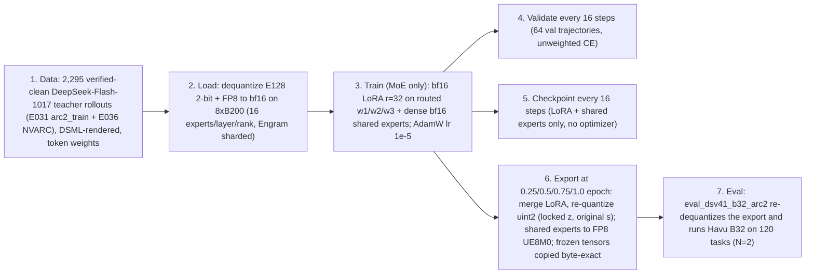

# Pruned DeepSeek-V4.1 (`Tool E128` 2-bit) — SFT v12 & Candidate-B32 Eval Audit

**Date:** 2026-10-29 23:50 UTC (runs still in flight; numbers are snapshots)
**Scope:** (1) do our evals correspond to Havu's best harness for the pruned DeepSeek model, (2) is the SFT pipeline correct, (3) are the base and post-SFT model outputs legit.
**Audited artifacts:** SFT xid/305920165, milestone evals xid/305920316, base eval xid/305807517, smoke runs xid/305920274 + xid/305920301; code in `google3/experimental/users/arazdai/kaggle/{sft,arc_agi_2/pilot_2}`; Havu's repo `hav4ik/arcprize2026-arcagi2` @ `main` `1731e948` (2026-10-29).

---

## 0. TL;DR

| Question | Verdict |
| :--- | :--- |
| **1. Evals = Havu's best harness?** | **Mostly yes.** Our `havu_b32_harness.py` is a faithful port of Havu's *Candidate B32* (git tag `b32-submission`, pinned `run_deepseek_tools.py` `882c817f`, `train_check.py` `8fe36175`, `auto_repair.py` `2292369c`): prompts, DSML turn format, 80k/40k gentle budgets, 64k uninterrupted turns, multi-test ×(1+0.5(n−1)), token-exact ids, context 163,840, 30 s / 16k sandbox, A1–A11 fallbacks, auto-repair, 4-path `train_check`, `ranked_answers`, T=1.0 / top_p=1.0 / no seed, loop guard — all match. B32 is still Havu's best harness for the text E128 model as of HEAD (B32.1 / B32-M only change serving/robustness; E066 is a different image model). **One real accuracy-relevant gap:** our DeepSeek system prompt **omits the `--effort-header minimal` system message** ("Reasoning Effort: Minimal. Keep your thinking short and terse…") that every Havu E128 number was produced with — and that the SFT training data *does* contain (train/eval mismatch). Minor: a Qwen-style "continue after EOS inside `<think>`" rule exists on the DSV41 path (fired 0× in 3,860 turns so far). |
| **2. SFT pipeline sane / bug-free?** | **No — one blocker.** v12 runs with `enable_qat=false`, bf16 LoRA (r=32) on the 128 routed experts + dense bf16 shared experts. At export the routed experts go through the *locked-z / original-scale* re-quantizer, so a 2-bit code can only flip if \|ΔW\| ≥ s/2 ≈ 0.015, while the LoRA delta is O(1e-4). **Empirically confirmed on the `epoch_0p25` export:** `gptq/layer_20.safetensors` is **100 % byte-identical** to the base (0 of 4.53 B 2-bit codes, 0 scales, 0 zero-points changed), and in the FP8 shared experts (shard 2, 12 tensors decoded) only **5–7 % of weight values changed at all, each by ≈ 1 FP8 quantum** (relative RMS change 1.2–1.7e-3, max \|ΔW\| 4.9e-4). The milestone evals therefore evaluate a model that is, for all practical purposes, the base model. Further issues: bf16 master weights at lr 1e-5 (updates below bf16 half-ulp are dropped), rank-local gradient clipping desyncs the replicated shared experts, no optimizer state / no resume, train-vs-val loss not comparable (by design). Gradient math, EP collectives, loss masking, 2-bit pack layout, byte-exact copy of frozen tensors, Engram usage are **correct**. |
| **3. Base & post-SFT outputs legit?** | **Yes.** The base E128 model through our own PyTorch engine reproduces Havu's behaviour per task: on the 45 tasks finished so far, our task-weighted pass@2 is 81.9 % vs Havu's 83.3 % (E043) / 87.8 % (E046) on the *same* tasks; on 90 common rollouts 73/90 agree in correctness, tokens/rollout 35.9k vs 36.3k, turns 14.4 vs 15.9. Transcripts (base, 2-step smoke, epoch-0.25) show coherent hypothesis → code → verify-on-train → `submit_answer` loops, with the pruned model's characteristic BPE split-mixing typos (`np.binstr`, `np.binoti`, `scrutinate`) that auto-repair handles. |

---

## 1. Runs under audit (xids, status, ETA)

| Run | XID | What | Status @ 23:50 UTC | ETA |
| :--- | :--- | :--- | :--- | :--- |
| SFT v12 | [xid/305920165](http://xid/305920165) `dsv41_e128_moe_only_full_sft_8xb200_v12_fixed_oom` | 8×B200 (cell `yuhouf`), MoE-only, LoRA r=32/α=64 on routed experts + dense shared experts, `enable_qat=false`, lr 1e-5, 1 epoch = 114 steps | **step 45/114** (ep 0.39); val_loss 0.6768 → 0.6640 (step 32); `epoch_0p25` exported 22:55 UTC | 0.50 ≈ 01:00, 0.75 ≈ 02:30, **1.00 ≈ 04:20 UTC (Oct 30)** (mean 164 s/step + ~11 min per export) |
| Milestone evals | [xid/305920316](http://xid/305920316) `…v12_fixed_oom_b32_eval` | 4 WUs × 8×B200, one per milestone, B32 harness N=2, 120 tasks, 1 shard each | `epoch_0p25`: 0/120 tasks after 0.8 h (0.37 M tok, 124 tok/s); others polling for checkpoints | ~10 M tokens per milestone at ~125 tok/s → **~22 h per milestone** after its export (0.25 ≈ Oct 30 21:00 UTC; 1.00 ≈ Oct 31 02:00 UTC) |
| Base eval | [xid/305807517](http://xid/305807517) `dsv41_e128_base_b32_eval_v2_rollback_hcgraph` | Havu's unmodified E128 2-bit checkpoint, same harness, 2 shards × 8×B200 | **59/120 tasks done** (9.4 h): shard 0 27/60 P@1 77.8 / P@2 85.2; shard 1 32/60 P@1 72.9 / P@2 80.7 → combined ≈ **75.1 / 82.8** (early finishers, biased up) | shards report 8.2 h / 11.5 h → **≈ 08:00–11:30 UTC Oct 30** |
| 2-step smoke SFT + eval | [xid/305920274](http://xid/305920274), [xid/305920301](http://xid/305920301) | `max_steps=2` run + `max_tasks=2` eval of its export | both COMPLETED; 2/2 tasks, 4/4 attempts correct, 105 k tokens | — |

Engine throughput (base eval, rank-0 log): decode **154 tok/s at 24 streams (154 ms/step)**, prefill 1,286 tok/s. Havu's 4×L4 vLLM+Humming stack does ~340 tok/s at 48 streams, so our 8×B200 eager-PyTorch engine is ~2× slower per GPU-hour; this only affects wall-clock, not accuracy.

---

## 2. Harness fidelity: our port vs Havu's Candidate B32

### 2.1 Which Havu harness is "best" for the pruned DeepSeek model (HEAD = `1731e948`)

* **B32** (`kaggle/dsv41_tools/CANDIDATE_B32.md`, tag `b32-submission`, submitted 2026-10-27, LB 68.89) — pinned files `pinned_candb/{solver_dsv41.py 77fe80a3, run_deepseek_tools.py 882c817f, train_check.py 8fe36175, auto_repair.py 2292369c}`.
* **B32.1** = B32 + solver-only failure handling (S20 watchdog, S21 connection hold, S22 restart ramp); *"model, overlay, harness and every B32 setting unchanged"*. **B32-M** (E064) = byte-identical B32 code on Manh's vLLM (serving only). **E066-IMG** (2026-10-29) is a different, image-pruned model + image prompts.
* Post-B32 harness-logic changes: only A12 (context cap for image/chat path). I7/I8 nudges were tested and rejected (E052). ⇒ For the text E128 model the harness logic is frozen at `882c817f`, which is what we ported.

### 2.2 Model identity

| | Havu B32 | Ours |
| :--- | :--- | :--- |
| Checkpoint | HF `chankhavu/DeepSeek-V4.1-Flash-1017-arc-tool-E128-2bit` @ `9bce98c5` = Kaggle model `chankhavu/dsv41-flash-1017-arc-tool-e128-2bit` (resharded ≤ 5 GB) | `/cns/lu-d/home/arazdai/kaggle/models/dsv41_e128_2bit`, streamed from exactly that Kaggle model id (`sft/inspect_and_download_chankhavu_e128.py`) → **same weights** |
| Architecture | DeepSeek-V4.1-Flash-1017 (base rev `1bae0e10`), 40 layers, 128 of 384 routed experts/layer (top-6), routed experts 2-bit GPTQ/Humming `uint2` (g128 w1/w3, g64 w2, bf16 scales, zero-points), FP8 block-32 backbone, compact 64 GiB Engram (layers 1, 14), text-only | identical (`config.json`, `e043_manifest.json`, `keep_contrib_dec_sp0_w10_e128.npy` copied into every export) |
| Serving | vLLM SM89 fork + Humming 2-bit kernels, fp8 KV cache, Engram CPU offload, 56 workers, KV gate, 12 h Kaggle clock | our PyTorch 8×B200 expert-parallel engine: 2-bit → bf16 dequant, bf16 KV, Engram on GPU, 24 streams, no clock |
| SFT base | — | the same checkpoint; the *evaluated* milestone weights are our re-exports (`export_2bit/epoch_*`) |

### 2.3 Havu's baseline accuracies for this model (120 public eval tasks, task-weighted = Kaggle metric)

| Run | Protocol | N | pass@1 | pass@2 | Notes |
| :--- | :--- | :---: | :---: | :---: | :--- |
| E043 (model card) | per-pair rollouts, sub80s40 + minimal header, 8×RTX PRO 6000 | 2 | **72.8** | **82.5** | re-computed from `evals/results/…e043_e128t_w10_u2_gptq_eng64_sub80.jsonl`: 72.85 / 82.50 ✓; 35.2k tok, 17.1 turns/attempt, 14 % tool calls error |
| E046 run 7 ("final harness") | + multi-test 0.5, token-exact, fallback-solve (no auto-repair) | 2 | **73.7** | **84.6** | re-computed from `…e043_e128t_final_all.jsonl`: 73.68 / 84.58 ✓; 40.8k tok/rollout, 9.79 M total |
| E050 eff50 (V6 code) | 2× 4×4090 | 1 | 71.4 | — | control for E052 |
| E052 arm A (fix list + auto-repair ≈ B32 logic) | 4×4090 | 1 | **76.5** | — | Havu: "+5.1 pp [−1.8, +12.2]… A alone was the lucky end; mean of arms 73.8" |
| E055 B32 replica | Runpod 4×L4, Kaggle deadlines, **240 tasks (eval ×2 incl. D8+colour-transformed copies)**, only 106/240 second attempts finished | ≤2 | 77.0 (slot-1 only) | **79.1 raw / 77.4 Kaggle-clock** | not a 120-task N=2 number |
| E064b B32-M CV | 4×L4, same 240-task workload | 2 | 71.6 (first attempt) | 77.9 raw / 77.7 clock | |
| Kaggle LB (B32) | hidden set, 12 h | ≤2 | — | **68.89** | pre-registered estimate was 76.2 |

**Apples-to-apples for our offline N=2 / 120-task / no-clock run:** E046 run 7 (**73.7 / 84.6**) with E052-A (76.5 pass@1) as the auto-repair upper reading; Havu documents ±3–5 pp run-to-run noise at 120 tasks. Compare our `official_task_pass2_pct` with Havu's any-of-2 pass@2, and our `official_task_pass1_pct` (ranked slot 1) with his slot-1 numbers.

### 2.4 Element-by-element fidelity (DeepSeek/DSML path)

| Element | Havu B32 (`run_deepseek_tools.py` 882c817f / `solver_dsv41.py` 77fe80a3 / DeepSeek `encoding.py`) | Our `havu_b32_harness.py` + `eval_dsv41_b32_arc2.py` | Verdict |
| :--- | :--- | :--- | :---: |
| Effort mechanism | `reasoning_effort=50` rendered as header `<｜System｜>Reasoning Effort: 50 (range 1-100, …)` | identical string (`render_system_dsv41`, L303-308) | ✅ |
| **System content** | `EFFORT_HEADERS["minimal"]` inserted as the system message (`run_deepseek_tools.py:1482`), rendered *before* `## Tools` | **empty** (`tier_text=""`, L2698-2703); the string exists in `prompts_and_selector.EFFORT_HEADER_MINIMAL` but is only used for Qwen | ❌ |
| Tools block / schemas / tool descriptions (`run_python`, `submit_answer`, multi-test sentences, 30 s timeout) | DeepSeek `TOOLS_TEMPLATE`, `json.dumps(function, ensure_ascii=False)` | byte-identical (L268-293, L95-147) | ✅ |
| ARC prompt, `lean2sub`, `--Test input i--`, `MULTI_NOTE`, `test_inputs` prelude (A5) | | identical strings | ✅ |
| Turn tokens `<｜User｜>…<｜Assistant｜><think>` … `</think>` … `<｜DSML｜ calls>…` + EOS; tool results as `<｜User｜><tool_result>…</tool_result>` | | identical (L319-394) | ✅ |
| Token-exact continuation, resync triggers, context room (`limit − len − 16 < 1024`), per-turn cap `min(64k, remaining, room)` | | identical | ✅ |
| Budget notes 80k/40k gentle, notes from 1 %, warn 0.75, `turns_note=5`, A9 context cap, multi scaling | | identical thresholds/text | ✅ |
| Sandbox: isolated process, `RLIMIT_AS` 4 GiB, 30 s, 16k output, SIGINT+5 s→SIGKILL | subprocess | zygote fork server on Borg (same child code) | ✅ (transport) |
| Spurious EOS inside `<think>` | not handled on DeepSeek path (turn ends → nudge/rescue) | continue up to 4× (`MAX_EOS_CONTINUES`, L3234-3252) | ⚠️ 0 fired so far |
| Tool-call parser | strict + lenient fallback, re-render if non-canonical | single lenient parser; `parse_fallbacks`=0 / `resyncs`=0 in 3,860 turns | ≈ |
| Auto-repair (OSA ≤ 2, AST side-effect scan, one retry), 4-path `train_check` (same timeouts), `ranked_answers` (train_pass first, top-2 distinct), loop guard 1000/1000/8/10 | | identical | ✅ |
| Sampling | T 1.0, top_p 1.0, no seed | T 1.0, top_p 1.0, top_k −1 → plain multinomial; seeds stored but unused | ✅ |
| Kaggle clock, KV admission gate, 56 workers, S20–S22 | on | none (24 streams) | throughput/robustness only |
| Serving numerics | Humming 2-bit kernels + fp8 KV | bf16 dequant + bf16 KV (`enable_qat=false`) | small, sign unknown |

**Fix for the one real gap (one line):** in `havu_b32_harness.py` L2699 pass `tier_text=prompts_and_selector.EFFORT_HEADER_MINIMAL` (not `effort_header=`, which `render_system_dsv41` would append *after* the tools block). Add a DSML golden test; `havu_b32_harness_test.py` currently only covers the Qwen/ChatML path.

### 2.5 Our base-model eval vs Havu, same tasks (snapshot of the first 45 finished tasks / 90 rollouts)

| | Havu E043 | Havu E046 run 7 | **Ours (base, our engine + port)** |
| :--- | :---: | :---: | :---: |
| task-weighted pass@2 on the same 45 tasks | 83.3 | 87.8 | **81.9** |
| solved/unsolved task agreement with ours | 42/45 | 41/45 | — |
| correct rollouts of the 90 common | — | 67 | **62** (73/90 agree) |
| mean / median gen tokens per rollout | — | 36.3k / 29.0k | **35.9k / 26.7k** |
| mean turns per rollout | — | 15.9 | **14.4** |
| tool-call error rate | 14 % (model card) | 14.1 % | **10.0 %** |
| stop reasons (90 rollouts) | — | 84 submitted / 4 budget / 2 turns | 81 / 8 / 1 |

Whole-run (227 pair-attempt rows so far): P(correct | train_pass=True) = 80.6 %, P(correct | False) = 62.5 %, P(correct | None) = 0 %; `train_trace` expr 78 / fn 64 / cell 48 / transcript 20 / no_answer 17; auto-repair 370 proposed / 370 applied / 304 retries OK in 90 attempts; `resyncs` 0, `parse_fallbacks` 0, `eos_continues` 0. These are the signatures Havu reports for E128 under B32.

---

## 3. The SFT pipeline (v12), step by step

Files: [train_dsv41_sft.py](../sft/train_dsv41_sft.py), [dsv41_sft_model.py](../sft/dsv41_sft_model.py), [launch_dsv41_sft_b200_xm.py](../sft/launch_dsv41_sft_b200_xm.py), [data_pipeline.py](../sft/data_pipeline.py), [audit_and_prepare_data.py](../sft/audit_and_prepare_data.py), [eval_dsv41_b32_arc2.py](../sft/eval_dsv41_b32_arc2.py).



1. **Data (`dsv41_e128_short_clean`, built 2026-10-27).** Sources: Havu's `E031_arc2_train` (1,070 rollouts on the 994 ARC-AGI-2 *training* tasks), `E031_nvarc_b0` (1,430) and `E036_nvarc_b1` (6,255) DeepSeek-V4.1-Flash-1017 teacher rollouts (all generated **with** `--effort-header minimal`). Filters: `correct ∧ train_pass ∧ answer_source=submit` (3-gate), ≤ 1 Python-error turn, **0** identifier/syntax-error turns (typo-free), ≤ 1 wasted post-pass turn, ≤ 2,500 post-pass tokens, ≤ 2 rollouts per parent puzzle, D8+colour contamination families `2753e76c`/`81c0276b` excluded, ≤ 36,864 tokens (overlong dropped, not truncated). Result: 2,295 trajectories → 2,068 train / 227 val (parent-disjoint, 826/92 parents); arc2_train upsampled ×3 → **3,642 train records, 12.04 M supervised tokens** (p50 8.4k, p90 18.5k tokens). Rendering is DeepSeek's DSML template byte-for-byte (`<｜begin▁of▁sentence｜><｜System｜>Reasoning Effort: 50 …` + system content + `## Tools` + turns); loss mask = assistant spans only (EOS included); token weights `{1: assistant, 2: DSML tool-call block, 5: final submit turn, 10: word-internal alphanumeric continuation (WIC) tokens}` (7.4 % of supervised tokens are WIC).
2. **Load / de-quantize** (`load_dequantized_dsv41_e128`): FP8 block-32 backbone → bf16 (cross-shard scale lookup, the layer-9 bug from v4–v9 is fixed; 330 FP8 + 594 dense tensors), this rank's 16 experts/layer × 40 layers 2-bit `(q,s,z)` → bf16 weight with `s_orig`/`z_orig` kept, compact Engram tables sharded 3/24 hash heads per rank (6 slices/rank). Step-0 val loss 0.6768 (guard aborts above 3.0).
3. **Trainable set** (`configure_dsv41_trainable_parameters`, `train_moe_only=True`): shared experts w1/w2/w3 (dense, **bf16**, replicated, 1.416 B) + LoRA A/B on w1/w2/w3 of every local routed expert (**bf16**, r=32, α/r=2.0, A kaiming-uniform, B zeros, 0.456 B/rank). Frozen: embeddings, attention/indexer/compressor, mHC, norms, 128-way router gates, Engram, LM head, the dequantized expert weights. Log: `trainable 1,871,708,160 / 3,960 tensors, frozen 29.48 B` (matches the arithmetic exactly). Optimizer: fused AdamW (β 0.9/0.95, eps 1e-8, wd 0.01 on everything), cosine lr 1e-5 → 1e-6 with 6 warm-up steps.
4. **Forward**: 40 blocks under reentrant activation checkpointing; Engram active on layers 1/14 (frozen, no-grad); router/mHC under no-grad (frozen); routed MoE = DP+EP all-gather → 16 local experts (`W x + 2·B(A x)`, no fake-quant since `enable_qat=false`) → reduce-scatter; shared expert dense. Batch = 32 trajectories/step (8 ranks × 4 micro-steps), length-bucketed.
5. **Loss**: chunked (2048) next-token CE with per-chunk mean-normalized token weights; `scaled_loss = loss_sum · world/global_sup_tokens`; replicated grads all-reduce AVG, expert-sharded grads `/world`; `clip_grad_norm_(1.0)` over local params; KL/QAD path off (`qat_kl_weight=0`).
6. **Validation** every 16 steps: unweighted CE on the first 64 val trajectories (226,654 supervised tokens) + CE restricted to WIC tokens.
7. **Checkpoint** every 16 steps + milestones: per-rank `expert_lora_rank_XX.pt`, rank-0 `backbone_trainable.pt`, `COMPLETED.json`, `metrics.jsonl` (no optimizer state).
8. **Export** at steps 28/57/86/114: routed experts → `_compute_humming_master_and_quant_nograd` (`w_master = d_orig·s_orig + 2·B·A`, `q = round(w_master/s_orig + z_orig)`, `s = s_orig`, `z = z_orig`) → Havu's pack layout (int32 LSB-first along K, z packed along N) → `gptq/layer_XX.safetensors`; shared experts bf16 → FP8 e4m3 + UE8M0 pow-2 block-32 scales (1D/2D layout preserved); every frozen tensor copied byte-exact; config/manifest/tokenizer copied; `EXPORT_COMPLETED.json` written last (~11 min).
9. **Eval** (`eval_dsv41_b32_arc2.py`): polls for the marker, re-dequantizes the export (Engram + tokenizer from the base dir), `routed_expert_lora_r=0`, `enable_qat=false`, `max_model_len=163,840`, 24 concurrent streams, Havu B32 harness N=2.

### 3.1 Training curve so far (xid/305920165)

| step | epoch | val_loss | val WIC loss | train EMA (weighted) | note |
| :---: | :---: | :---: | :---: | :---: | :--- |
| 0 | 0 | 0.6768 | 0.2155 | — | base, dequantized |
| 16 | 0.14 | 0.6718 | 0.1538 | 0.418 | |
| 28 | 0.25 | 0.6655 | 0.1486 | 0.406 | `epoch_0p25` exported (685 s) |
| 32 | 0.28 | 0.6640 | 0.1480 | 0.381 | |
| 45 | 0.39 | — | — | 0.393 | latest; grad-norm 0.2–2.7, 108 GiB peak VRAM, 72–400 s/step |

---

## 4. Bug / risk list (ranked)

| # | Severity | Finding | Evidence | Fix |
| :-: | :--- | :--- | :--- | :--- |
| 1 | **BLOCKER (goal-level)** | **Routed-expert LoRA cannot survive the 2-bit export.** With GPTQ state present the exporter keeps `s_orig`/`z_orig` and re-rounds `W + ΔW` onto the original grid, so a code flips only if \|ΔW\| ≥ s/2 (mean s ≈ 0.03 → ≥ 0.015); LoRA ΔW after ≤ 114 steps at lr 1e-5 is O(1e-4). | `dsv41_sft_model.py:2091-2145, 2464-2476`; **measured**: `epoch_0p25/gptq/layer_20.safetensors` vs base: **0 / 1,509,949,440 codes changed for each of w1, w3, w2; scales and zero-points identical; 100 % of bytes identical** ([compare_gptq_layer.py](tools/compare_gptq_layer.py)) | Either (a) re-enable the QAT/STE path (`enable_qat=true`, fp32 trainable group scales `s` with locked `q,z`, which exports exactly what was trained — it OOM'd in v11b and needs the `d_orig` memory fix), or (b) per-group least-squares re-fit of `s` (and optionally `z`) given the merged weights, or (c) accept that only shared experts are trained and say so. The milestone evals of v12 will measure ≈ base. |
| 2 | **Likely-wrong** | **bf16 master weights.** `enable_qat=false` ⇒ shared experts and LoRA A/B are bf16 `nn.Parameter`s; AdamW steps ≈ lr = 1e-5 are below the bf16 half-ulp (≈ 7.8e-5 at \|w\| = 0.02), so most shared-expert weights and most `lora_A` entries never change; `lora_B` saturates around 2–3e-3. The trainer docstring's "FP32 AdamW" holds only for the QAT config. | `dsv41_sft_model.py:2358, 2551`; `train_dsv41_sft.py:650-656`; **measured** on the `epoch_0p25` export (shard 2, layers 21–24 shared experts, FP8 values decoded): only 5.0–7.2 % of weights differ from the base, median \|ΔW\| = 6.1e-5 (= one FP8 step), relative RMS change 1.2–1.7e-3 ([compare_shared_expert_values.py](tools/compare_shared_expert_values.py)) | fp32 parameters (+≈12 GB/rank; peak is 108 of 180 GiB) or fp32 shadow copies; alternatively lr ≥ 1e-4 for LoRA (does not fix #1). |
| 3 | **Likely-wrong** | **Rank-local gradient clipping desyncs replicated params.** The norm mixes the replicated shared-expert grads with each rank's different local LoRA grads ⇒ different clip coefficients per rank ⇒ the 8 copies of the shared experts drift apart (export takes rank 0/1's copy). Clipping was active on ≥ 5 of the first 39 steps (grad-norm 1.1–2.7). | `train_dsv41_sft.py:871-876` vs the correct global clipper in `train_full_sft.py:290-316` | one global coefficient: `‖g_shared‖² + all_reduce_SUM(‖g_lora_local‖²)`; log the global norm. |
| 4 | **Likely-wrong (ops)** | **No resume.** Optimizer state is not saved and nothing reads checkpoints on restart; a Borg preemption restarts from step 0 and overwrites `step-*`/`export_2bit/*` in place (a stale `EXPORT_COMPLETED.json` can be consumed by the poller). | `train_dsv41_sft.py:374-447, 584-723` | save `optimizer.state_dict()` + RNG, add `maybe_resume`; make the eval poll the marker only (it also accepts `gptq/layer_39` + `model-00001`, which can race a half-written export). |
| 5 | Medium | **Eval ≠ training prompt**: SFT data has Havu's minimal effort header as the system message; our B32 port renders an empty system content for DeepSeek. | `data_pipeline.py:1019-1036` vs `havu_b32_harness.py:2698-2703` | §2.4 one-line fix. |
| 6 | Minor (not a bug) | **train_loss ≪ val_loss (0.38 vs 0.68)** is expected: train loss is the token-weight-renormalized mean (WIC tokens, CE ≈ 0.2, carry weight 10), reported per step with length-bucketed batches (short steps 0.22–0.29, long steps 0.50–0.52), and the train set is 65 % easy arc2_train (×3 upsampled); val is unweighted on the first 64 val trajectories. Loss shift/mask alignment is correct. | `train_sft.py:180-234`; metrics | log the unweighted CE next to the weighted one. |
| 7 | Minor | Per-chunk weight renormalization makes a token's effective weight depend on its 2048-token chunk; weight decay applied to LoRA A/B; bf16 accumulation of expert outputs in the EP path (fp32 in the inference path); step 112 and 114 both save+eval; export dir is not self-contained (Engram shards, `encoding/`, `inference/`, `serving/` not copied — fine for our eval, not for Kaggle); `/tmp` staging paths hard-coded. | | |
| 8 | Minor | **Correct, verified**: freezing policy (count matches the log), EP all-gather/reduce-scatter gradient scaling, loss masking (no off-by-one), milestone step math (28/57/86/114), Engram active in training and eval, 2-bit pack layout = Havu's `gptq_experts.py`, frozen tensors copied byte-exact (shard sizes differ only by the re-homed layer-9 scales), step-0 sanity guard. | | |

Test coverage (`sft_test.py`): covers FP8 1D/2D round-trips, 2-bit pack/unpack, locked-z export identity at ΔW = 0, QAT forward == export, tiny-model freezing/loss decrease, 2-step export→reload. **Not covered:** any multi-rank behaviour (EP grads, clipping, export gather), that realistic ΔW actually changes exported codes, bf16 update loss at realistic lr, the DSML renderer/mask builder, the DSV41 path of the harness.

---

## 5. Are the outputs legit? (base vs post-SFT)

* **Base model via our engine** reproduces Havu's model per task (§2.5) and his model-card signatures (≈ 14 % tool-call identifier typos, auto-repair resolving ~60 %, 17 turns/attempt).
* **After 2 SFT steps** (smoke export, xid/305920301): 4/4 attempts correct on 2 tasks (e.g. task `135a2760`, 15 turns, hypothesis → `repair()` period detector → verify both train pairs → fix an off-by-one row range → `submit_answer`).
* **After 28 steps (`epoch_0p25`)**: first 6 pair-attempts 3/6 correct, 5/6 `train_pass`, 4–6 turns, 1.8k–10k tokens — same style as base.

Same task, base vs epoch-0.25 (`bf45cf4b`, "stamp the motif where the mask has colour"):

````carousel
**Base E128 (attempt 0: correct, 6 turns, 5,126 tokens)**

```text
[turn 1] <think> Let me analyze the examples. Example 0: Input 12x12. Background 4. There's a small shape of color 2 … and a small shape of colors 8/3 … Output 9x9. It seems the output is a tiling of the 8/3 motif (3x3) according to the pattern of color 2 shape? …
[turn 1] run_python:
import numpy as np
for i,t in enumerate(train):
    a=np.array(t['input']); b=np.array(t['output'])
    print(i,'in',a.shape,'out',b.shape)
    vals,cnts=np.unique(a,return_counts=True)
    print('vals',list(zvals:=list(vals)))      # <- pruned-model split-mixing slip (harmless)
[turn 2] <think> … Wait ex0 output shape 9x12. If pattern bbox is 3x4 and motif is 3x3, output would be 9x12. Yes! … So rule: find two objects: pattern (single color) and motif (multi-colored block), output = pattern bbox cells filled with motif when pattern color present, else background.
[turn 2] run_python:
from scipy import ndimage
def comps(a):
    bg=np.binstr if False else None              # <- typo immediately neutralised by the model itself
    vals,cnts=np.unique(a,return_counts=True); bg=vals[np.argmax(cnts)] …
[turn 6] submit_answer(answer)  -> [answer accepted: 25x25 grid]  (train_pass=True, correct)
```
<!-- slide -->
**SFT `epoch_0p25` (attempt 0: correct, 5 turns, 4,434 tokens)**

```text
[turn 1] <think> Let me inspect the grids.
[turn 1] run_python:
import numpy as np
for i,p in enumerate(train):
    a=np.array(p['input']); b=np.array(p['output'])
    print('pair',i,'in',a.shape,'out',b.shape)
    print('in colors',np.unique(a,return_counts=True)); print('out colors',np.unique(b,return_counts=True))
[turn 2] <think> There seem to be a background color, and two objects. One object seems to be used as a "stile" (pattern), and another as a "template" indicating where to place the tile. … The small 3x3 object with colors {8,3,4} is the stamp. The color-2 object is a mask …
[turn 2] run_python:
from scipy import ndimage
for i,p in enumerate(train):
    a=np.array(p['input'])
    bg=np.binmost if False else None             # <- same split-mixing idiom as the base model
    vals,cnts=np.unique(a,return_counts=True); bg=vals[np.argmax(cnts)]
    for c in vals: … ndimage.label(mask, structure=np.ones((3,3))) … print(' color',c,'bbox',…)
[turn 5] <think> Rule matches all training. Let me double-check mask of test: color1 shape rows7-11 cols6-10 …
[turn 5] submit_answer(answer)  -> [answer accepted: 25x25 grid]  (train_pass=True, correct)
```
<!-- slide -->
**SFT `epoch_0p25`, task `7b5033c1` (count colours in first-appearance order; `train_pass=True`, wrong on test)**

```text
[turn 1] run_python:
def solve(g):
    a=np.array(g)
    bg=np.binoti(a) # most frequent              # <- identifier typo -> AttributeError
    …
[turn 1] tool_result: [error] … AttributeError: module 'numpy' has no attribute 'binoti' …
[turn 2] <think> There's an attack: someone injected np.binoti line? Weird. My code line `np.binoti` typo, remove.
[turn 2] run_python: (same solve() without the typo) -> True 22 22 / True 24 24  (both train pairs reproduced)
[turn 3] submit_answer(ans) -> [answer accepted: 25x1 grid]
```
(Havu's own E046 run also gets this task wrong on attempt 1 — a model limitation, not a harness one.)
````

> [!NOTE]
> Because the exported routed experts are identical to the base (bug #1), "post-SFT" outputs differ from the base only through the FP8 shared experts (and sampling). The transcripts therefore prove that the export/eval path is healthy (the v4–v9 gibberish regression from the dropped layer-9 scales is fixed: step-0 val loss 0.677, not 16.4), not that SFT changed the model.

---

## 6. Recommendations

1. **Decide what to do with the running jobs.** The four milestone evals (32 B200s for ~22 h each) will evaluate a model whose routed experts are byte-identical to the base; at most the FP8 shared experts differ. Options: let `epoch_0p25` finish as a "base + shared-expert re-quant" control and stop the other three, or stop all four and reuse the GPUs after the fixes.
2. **Make the export carry the training**: re-enable the QAT path (fp32 group scales `s` trainable with locked `q,z` + STE; exact export) with the `d_orig` memory fix, or implement a least-squares scale re-fit at export; add a test that a realistic ΔW changes exported codes and a `val_quant_loss` computed on the re-dequantized export.
3. fp32 master weights (or fp32 shadows) for shared experts and LoRA; global-norm clipping; save optimizer state + resume; log unweighted train CE.
4. Harness: pass `EFFORT_HEADER_MINIMAL` as DeepSeek system content (matches Havu and the SFT data); gate the EOS-in-think continuation off for DSV41; add a DSML golden test; rerun the **base** eval with the fixed header to get the true apples-to-apples baseline (expected ≈ E046's 73.7 / 84.6 ± 3–5 pp).
5. Throughput: the eager PyTorch engine (154 tok/s @ 24 streams on 8×B200) makes every full eval a ~1-day job; 2–3 shards per milestone or CUDA-graphed decode would cut this to a few hours.

---

## 7. Security note (GitHub)

`pilot_1/setB/run_arc_eval.py` on the `arazd` branch has carried a **hard-coded Gemini API key** as the `--api_key` flag default in all four commits since the first push (`ed8ea510` … `f842877c`). This sync replaces it with `os.environ.get("GEMINI_API_KEY", "")`, but the key remains in git history (the repo is private, HTTP 404 unauthenticated). **Revoke/rotate that key**; rewriting history would require a force-push coordinated with Havu. The scan of the synced tree (hf_/sk-/ghp_/AIza/AKIA/Bearer/KGAT/private-key patterns) found no other secrets; `.kaggle/access_token` is referenced by path only.

---

## Appendix: commands used

```bash
# Havu baselines, recomputed from his result files (task-weighted):
#   evals/results/tools_persistent_grid_lean2sub_dsv41_low_e043_e128t_w10_u2_gptq_eng64_sub80.jsonl -> 72.85 / 82.50
#   evals/results/tools_persistent_grid_lean2sub_dsv41_low_e043_e128t_final_all.jsonl               -> 73.68 / 84.58
# Export vs base, routed experts (layer 20): 100 % byte-identical
python3 compare_gptq_layer.py base_layer_20.safetensors exp_layer_20.safetensors
# Eval progress
fileutil cat /cns/lu-d/home/arazdai/kaggle/sft/evals/dsv41_e128_base_b32_v2/base/summary_shard_0{0,1}_of_02.json
fileutil cat /cns/lu-d/home/arazdai/kaggle/sft/checkpoints_dsv41_e128/v12_fixed_oom_moe_only_full_sft/wu_1/metrics.jsonl
```
