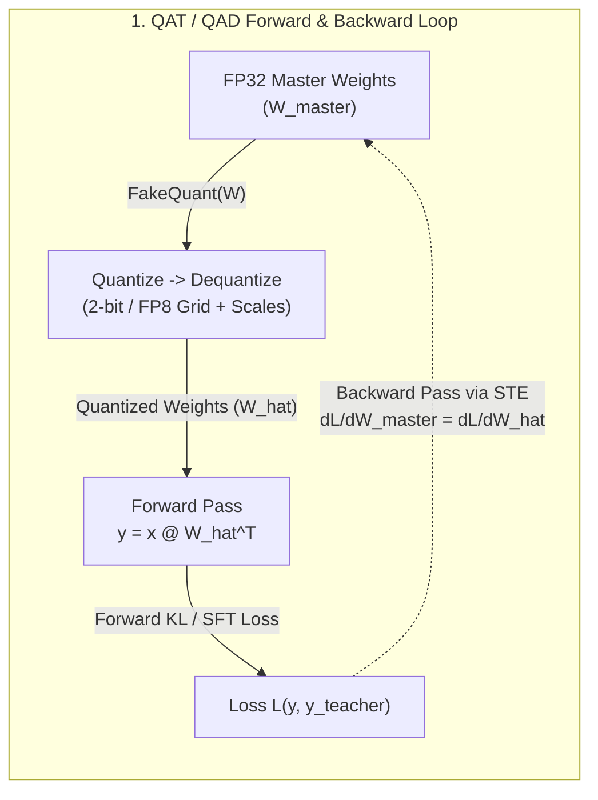
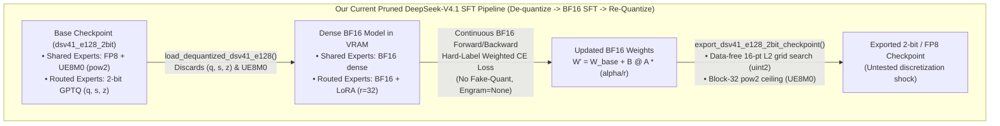

# Summary Report: Quantization-Aware Training (QAT) vs. Our Pruned DeepSeek-V4.1 (`Tool E128`) SFT Pipeline & Improvement Roadmap

**Date:** 2026-10-29  
**Scope:** Architectural summary of Quantization-Aware Training (QAT) and Quantization-Aware Distillation (QAD), line-by-line comparison against our current Pruned DeepSeek-V4.1 (`Tool E128`) SFT and 2-bit/FP8 quantization pipeline, and a prioritized roadmap of concrete engineering improvements.

> [!NOTE]
> **Related Reports in [`kaggle/arc_agi_2/reports/`](file:///google/src/cloud/arazdai/test_workspace/google3/experimental/users/arazdai/kaggle/arc_agi_2/reports/):**
> - [Full Recovered Report: NVIDIA Nemotron (NVFP4) vs. Pruned DeepSeek-V4.1 (`qat_sft_nemotron_vs_dsv41_report.md`)](file:///google/src/cloud/arazdai/test_workspace/google3/experimental/users/arazdai/kaggle/arc_agi_2/reports/qat_sft_nemotron_vs_dsv41_report.md) ([HTML](file:///google/src/cloud/arazdai/test_workspace/google3/experimental/users/arazdai/kaggle/arc_agi_2/reports/qat_sft_nemotron_vs_dsv41_report.html))
> - [DeepSeek Pruning & SFT Report (`deepseek_pruning_and_sft_report.md`)](file:///google/src/cloud/arazdai/test_workspace/google3/experimental/users/arazdai/kaggle/arc_agi_2/reports/deepseek_pruning_and_sft_report.md) ([HTML](file:///google/src/cloud/arazdai/test_workspace/google3/experimental/users/arazdai/kaggle/arc_agi_2/reports/deepseek_pruning_and_sft_report.html))

---

## 1. Executive Summary: What is Quantization-Aware Training (QAT)?

Standard **Post-Training Quantization (PTQ)** treats model training and weight compression as two disconnected steps: a model is first trained in continuous high precision (`BF16`/`FP32`), and its weights are subsequently rounded or packed into low-bit formats (`FP8`, `INT4`, `UINT2`) after training finishes. While PTQ works reasonably well at 8-bit precision, it suffers severe accuracy degradation at **ultra-low bit-widths (2-bit to 4-bit)** or in **sparse Mixture-of-Experts (MoE)** architectures where quantization noise alters hidden-state trajectories and triggers routing shifts across downstream layers.

**Quantization-Aware Training (QAT)** and **Quantization-Aware Distillation (QAD)** (as formalized in NVIDIA's Nemotron 3 / NVFP4 papers, *arXiv:2509.25149* and *arXiv:2601.20088*) solve this by **simulating the exact target quantization grid inside the forward pass during training**:



### The 5 Pillars of Modern QAT / QAD

1. **Fake-Quantization in `forward()` with Straight-Through Estimator (STE) in `backward()`:**
   - **Forward pass:** Before every matrix multiplication, high-precision master weights $W_{\text{master}}$ are projected onto the discrete target grid and immediately de-quantized back to the compute dtype:
     $$\widehat{W} = W_{\text{master}} + \text{stop\_grad}\big(\text{Dequant}(\text{Quant}(W_{\text{master}})) - W_{\text{master}}\big)$$
   - **Backward pass:** Because rounding $\lfloor \cdot \rceil$ has zero derivative almost everywhere, the **Straight-Through Estimator (STE)** passes the gradient $\nabla_{\widehat{W}} \mathcal{L}$ directly to $W_{\text{master}}$. Every layer therefore sees the true quantization noise of all preceding layers during training.
2. **FP32 Master Weights (Preventing Mantissa Underflow):**
   - SFT learning rates (`1e-6` to `1e-5`) produce tiny per-step updates ($\Delta w \sim 10^{-6}$). In `BF16` (7-bit mantissa, $\text{ULP} \approx 7.8 \times 10^{-4}$ for $|w| \approx 0.1$), small updates underflow to zero before they can accumulate across steps to cross a discrete 2-bit or FP8 step boundary. QAT maintains trainable master weights in **`FP32`** so gradients accumulate smoothly until they cross a quantization threshold.
3. **Preserving Calibration Scales / Codebooks (Scale-Aware Adaptation):**
   - When starting from a pre-quantized checkpoint (such as GPTQ or AWQ), the integer codes $q$ and zero-points $z$ were carefully solved using activation Hessians ($H = X X^\top$) so rounding errors cancel across input channels. Modern QAT for ultra-low-bit models either **locks the calibrated integer codes/zero-points and trains the continuous group scales $s$**, or updates weights through an STE operator with frozen zero-points so Hessian error cancellation is never destroyed by naive re-packing.
4. **Selective Precision Guardrails:**
   - Not all components tolerate ultra-low precision. NVIDIA's NVFP4 recipe keeps embeddings, LM head, RMSNorms, attention projections/softmax, MoE router gates (`DifferentiableGate`), and the final $\sim 15\%$ of layers in higher precision (`BF16`/`FP16`/`FP8`) while quantizing the heavy FFN/MoE expert matrices.
5. **Quantization-Aware Distillation (QAD — Forward KL vs. Hard-Label CE):**
   - Under 2-bit/4-bit quantization noise, training solely on hard one-hot token cross-entropy ($\text{CE}(y_{\text{hard}}, P_\theta)$) produces high-variance gradients that push weights back and forth across discrete rounding boundaries ("weight oscillation"). Minimizing **Forward KL Divergence** ($D_{\text{KL}}(P_{\text{teacher}} \parallel P_{\text{quant-student}})$ at $T=1.0$) against the dense/base model's full logit distribution provides dense, low-variance gradients that keep hidden-state norms aligned with frozen MoE routers.

---

## 2. How Our Current Pruned DeepSeek-V4.1 (`Tool E128`) Pipeline Works vs. QAT

Our current pipeline in [`train_dsv41_sft.py`](file:///google/src/cloud/arazdai/test_workspace/google3/experimental/users/arazdai/kaggle/sft/train_dsv41_sft.py) and [`dsv41_sft_model.py`](file:///google/src/cloud/arazdai/test_workspace/google3/experimental/users/arazdai/kaggle/sft/dsv41_sft_model.py) is a **"De-quantize $\rightarrow$ Continuous BF16 SFT $\rightarrow$ Data-Free Post-Training Re-Quantize"** workflow, **not** true QAT.



### Side-by-Side Comparison: QAT / QAD vs. Our Current Pipeline

| Dimension | Standard QAT / QAD (e.g., NVIDIA Nemotron NVFP4) | Our Pruned DeepSeek-V4.1 (`Tool E128`) Pipeline | Impact on Our SFT Run |
| :--- | :--- | :--- | :--- |
| **1. Forward Pass Precision During Training** | **Simulated Quantization (`FakeQuant`):** Weights pass through `Dequant(Quant(W))` on every forward step. | **Pure Continuous `BF16`:** [`LoRALinear.forward`](file:///google/src/cloud/arazdai/test_workspace/google3/experimental/users/arazdai/kaggle/sft/dsv41_sft_model.py#L1050-L1055) and [`SwiGLUExpert.forward`](file:///google/src/cloud/arazdai/test_workspace/google3/experimental/users/arazdai/kaggle/sft/dsv41_sft_model.py#L1082-L1094) execute strictly in continuous `BF16`/`FP32`. | **High Risk:** The optimizer relies on continuous micro-adjustments that vanish or jump unpredictably when snapped back to 2-bit/FP8 at export. |
| **2. Loading Pre-Quantized Checkpoints** | Retains quantization structure (`scales`, `zero_points`) and simulates quantization grid in-place. | [`load_dequantized_dsv41_e128`](file:///google/src/cloud/arazdai/test_workspace/google3/experimental/users/arazdai/kaggle/sft/dsv41_sft_model.py#L1794-L1929) unpacks 2-bit `(q, s, z)` and FP8 `(w, scale_inv)` into dense `BF16` and **discards the original `(q, s, z)` tensors**. | **High Risk:** Loses Havu's activation-calibrated GPTQ integer lattice (`q`) and zero-points (`z`). |
| **3. 2-Bit Routed Expert Export (`uint2` Humming)** | Exports the exact quantized weights already simulated during the QAT forward pass (zero export mismatch). | [`quantize_uint2_humming_expert_tensor`](file:///google/src/cloud/arazdai/test_workspace/google3/experimental/users/arazdai/kaggle/sft/dsv41_sft_model.py#L175-L243) runs a **data-free 16-point min-max L2 grid search** over `z in {0,1,2,3}` and `shrink in {1.0..0.85}` on `W_base + LoRA`. | **Critical Vulnerability:** Unweighted L2 re-quantization flips integer codes `q` and zero-points `z`, breaking GPTQ's activation-weighted Hessian compensation ($H = X X^\top$). |
| **4. Shared Expert Export (`FP8` + `UE8M0` Scale)** | Simulates block-scale rounding in the forward pass so weights adapt to scale steps. | [`quantize_fp8_block32_torch`](file:///google/src/cloud/arazdai/test_workspace/google3/experimental/users/arazdai/kaggle/sft/dsv41_sft_model.py#L89-L115) computes `amax / 448.0` and takes an **IEEE-754 power-of-two ceiling (`exp_ceil`)** only at export time. | **Medium-High Risk:** If one weight in a 32-element block crosses a $2^k \times 448$ threshold, the block scale **doubles** ($2\times$), halving the FP8 precision of the other 31 weights in that block. |
| **5. Master Weight Dtype** | **`FP32` Master Weights** so small updates (`lr=1e-6` to `1e-5`) accumulate cleanly across steps. | Trainable `shared_experts` ([`dsv41_sft_model.py:L1074-L1076`](file:///google/src/cloud/arazdai/test_workspace/google3/experimental/users/arazdai/kaggle/sft/dsv41_sft_model.py#L1074-L1076)) and `lora_A/B` ([`dsv41_sft_model.py:L1039-L1044`](file:///google/src/cloud/arazdai/test_workspace/google3/experimental/users/arazdai/kaggle/sft/dsv41_sft_model.py#L1039-L1044)) are stored in **`torch.bfloat16`**. | **Medium Risk:** At `lr=8e-6`, many gradient updates fall below `BF16` machine epsilon ($\text{ULP} \approx 8 \times 10^{-4}$) and stagnate. |
| **6. Training Objective & Frozen Router Alignment** | **Forward KL Distillation (QAD)** against teacher logits keeps hidden-state distributions stable for frozen routers. | Hard-label token-weighted Cross-Entropy (`WIC-alnum=10.0, submit=5.0, tool=2.0`) with frozen 128-expert gates. | **Medium Risk:** Hard CE with high token weights (`10.0x`) can shift inter-layer hidden states enough to mis-route tokens in deeper frozen gates. |
| **7. Validation & Checkpoint Selection** | Evaluates validation loss using the **quantized** forward pass (`val_quant_loss`). | [`evaluate_dsv41_validation_loss`](file:///google/src/cloud/arazdai/test_workspace/google3/experimental/users/arazdai/kaggle/sft/train_dsv41_sft.py#L284-L372) evaluates the **unquantized `BF16`** model (`val_loss`). | **High Risk:** `BF16` `val_loss` can monotonically improve while the re-quantized 2-bit checkpoint degrades on ARC-AGI-2. |
| **8. Engram Conditional Memory (Layers 1 & 14)** | Trains and evaluates with all active inference modules present. | [`Dsv41SftModel.forward_hidden`](file:///google/src/cloud/arazdai/test_workspace/google3/experimental/users/arazdai/kaggle/sft/dsv41_sft_model.py#L1703) passes `engram_hash_ids=None`, bypassing [`CompactEngramModule`](file:///google/src/cloud/arazdai/test_workspace/google3/experimental/users/arazdai/kaggle/sft/dsv41_sft_model.py#L1428-L1442) during SFT. | **Medium Risk:** Train-test residual mismatch on layers 1 and 14 when the SGLang/Hummingbird B32 harness enables Engram at inference time. |

---

## 3. Deep Dive into the 3 Core Quantization Bottlenecks in `dsv41_sft_model.py`

### Bottleneck A: Why `quantize_uint2_humming_expert_tensor` Hurts Havu's 2-Bit GPTQ Weights
In [`dsv41_sft_model.py:L175-L243`](file:///google/src/cloud/arazdai/test_workspace/google3/experimental/users/arazdai/kaggle/sft/dsv41_sft_model.py#L175-L243), milestone export merges the LoRA adapter into the dequantized 2-bit expert weight ($W_{\text{merged}} = W_{\text{deq}} + \frac{\alpha}{r} B A$) and calls [`quantize_uint2_humming_expert_tensor`](file:///google/src/cloud/arazdai/test_workspace/google3/experimental/users/arazdai/kaggle/sft/dsv41_sft_model.py#L175-L243):

```python
# Current export logic in dsv41_sft_model.py (lines 213-228)
for z_val in (0.0, 1.0, 2.0, 3.0):
    z_cand = torch.full_like(w_min, z_val)
    s_base = torch.maximum((w_max - w_min) / 3.0, ...).clamp_min(1e-6)
    for shrink in (1.0, 0.95, 0.90, 0.85):
        s_cand = (s_base * shrink).to(torch.bfloat16).float()
        q_cand = torch.clamp(torch.round(wg / s_cand.unsqueeze(-1) + z_cand.unsqueeze(-1)), 0.0, 3.0)
        deq = (q_cand - z_cand.unsqueeze(-1)) * s_cand.unsqueeze(-1)
        err = (deq - wg).square().sum(dim=-1)  # <-- Unweighted Frobenius (L2) error!
```

**Why this is problematic:**
1. **Original Checkpoint (`dsv41_e128_2bit`):** Havu quantized the 128 experts using **GPTQ**, which minimizes the **activation-weighted** output error $\|(W - \widehat{W}) X\|_2^2 = \text{Tr}\big((W - \widehat{W}) H (W - \widehat{W})^\top\big)$. In 2-bit GPTQ (only 4 levels: `{0, 1, 2, 3}`), GPTQ intentionally rounds column $j$ *up* and column $j+k$ *down* based on the inverse Hessian $H^{-1}$ so their errors cancel in the dot product $w \cdot x$.
2. **What happens during our export:** When LoRA adds a small perturbation $\Delta W$ to a 64- or 128-element group, the 16-point grid search re-evaluates `z_val in {0, 1, 2, 3}` and `shrink in {1.0, 0.95, 0.90, 0.85}` using **unweighted** L2 error `(deq - wg).square().sum(dim=-1)`. Even if $\Delta W$ is tiny ($\sim 10^{-3}$), this unweighted search can pick a **different zero-point $z$ or shrink factor** than Havu's original GPTQ solver, flipping multiple 2-bit codes $q \in \{0, 1, 2, 3\}$ inside the group and destroying the Hessian error cancellation.
3. **Dead-Zone Wipeout:** Conversely, for groups where $z$ and $s$ do *not* flip, the 2-bit step size $s \approx \frac{w_{\max} - w_{\min}}{3} \approx 0.03\text{–}0.08$ is $10\times$ to $50\times$ larger than a typical LoRA weight delta ($\|\Delta W\|_\infty \sim 10^{-3}$). Thus $\text{round}(W_{\text{deq}}/s + \Delta W/s + z)$ simply rounds $\Delta W/s$ back to `0`, erasing the learned LoRA update on 85–95% of weights while causing discrete $\pm s$ jumps on the remaining 5–15% that happened to sit near a half-integer boundary.

### Bottleneck B: `UE8M0` Power-of-Two Scale Jumps in `quantize_fp8_block32_torch`
In [`dsv41_sft_model.py:L89-L115`](file:///google/src/cloud/arazdai/test_workspace/google3/experimental/users/arazdai/kaggle/sft/dsv41_sft_model.py#L89-L115), `shared_experts` are exported to `float8_e4m3fn` with `UE8M0` scales:

```python
# Current FP8 + UE8M0 quantization in dsv41_sft_model.py (lines 100-108)
amax = blocks.abs().amax(dim=-1)
raw_scale = torch.clamp(amax / 448.0, min=2.0**-126)
bits = raw_scale.view(torch.int32)
exp = (bits >> 23) & 0xFF
mant = bits & 0x7FFFFF
exp_ceil = torch.clamp(exp + (mant != 0).to(torch.int32), 0, 254)  # <-- Power-of-2 ceiling!
```

Because `UE8M0` has **0 mantissa bits**, `scale_f32` can only take exact powers of two ($2^{-127}, 2^{-126}, \dots, 2^0, \dots$). During continuous `BF16` training, `shared_experts` weights evolve freely. If the largest weight in a 32-element block creeps from $448 \times 2^{-6} - \epsilon$ to $448 \times 2^{-6} + \epsilon$, `exp_ceil` increments by `1`, **doubling the scale factor** for that block at export time and forcing all 32 weights in the block onto a $2\times$ coarser FP8 grid that was never seen during training.

---

## 4. How Our Pruned DeepSeek SFT Run Can Be Improved (Prioritized Roadmap)

Below are the **5 highest-leverage improvements** ranked by engineering simplicity and expected impact on exported 2-bit/FP8 ARC-AGI-2 accuracy.

### Improvement 1 (Highest Leverage & Zero Re-Packing Loss): Direct Group-Scale QAT (`Trainable s` with Frozen GPTQ `q, z`)
Instead of de-quantizing the 2-bit routed experts into dense `BF16`, adding a `BF16` LoRA adapter, and destructively re-packing `(q, s, z)` from scratch at export:
- **Keep Havu's GPTQ packed 2-bit codes `q` (`uint8`) and zero-points `z` (`uint8`) frozen in memory**, and make the **per-group scale tensor `s` (`[N, K // group]`, where `group=128` for `w1, w3` and `group=64` for `w2`) directly trainable in `FP32`** (or parameterized as $s = s_{\text{orig}} \cdot (1 + \Delta s)$ initialized at $\Delta s = 0$).
- **Why this works so well for 2-bit MoE:**
  1. **Preserves GPTQ Hessian Calibration:** Because $q$ and $z$ are never altered, the relative intra-group weight structure calibrated by Havu's GPTQ Hessian is 100% preserved.
  2. **Exact Export (`0.0` Quantization Discrepancy):** At checkpoint export, we simply cast the learned scale `s.to(torch.bfloat16)` and write it directly into `gptq/layer_XX.safetensors` alongside the original packed `q` and `z`. **The exported model is bit-for-bit identical to the model evaluated during training.**
  3. **Massive VRAM & Expressivity Advantage:** Across 40 layers $\times$ 128 experts, the group scales `s` for `w1` (`[128, 2048, 32]`), `w3` (`[128, 2048, 32]`), and `w2` (`[128, 4096, 32]`) total **1.34B trainable scale parameters globally (`167.8M` per GPU across 8 GPUs)**—more fine-grained channel-group expressivity than `r=32` LoRA (`1.21B` params globally), while requiring **zero re-quantization grid search** at export!

### Improvement 2: Add Straight-Through Estimator (STE) Fake-Quantization to `SwiGLUExpert` & `LoRALinear`
If we keep `shared_experts` dense and/or keep `LoRALinear` on routed experts, we should inject **STE Fake-Quantization** directly into [`dsv41_sft_model.py`](file:///google/src/cloud/arazdai/test_workspace/google3/experimental/users/arazdai/kaggle/sft/dsv41_sft_model.py):

1. **For `shared_experts` (`FP8 + UE8M0` STE):**
   ```python
   def fake_quant_fp8_block32_ste(w: torch.Tensor) -> torch.Tensor:
       with torch.no_grad():
           w_fp8, s_u8 = quantize_fp8_block32_torch(w)
           w_deq = dequantize_fp8_block32_torch(w_fp8, s_u8, out_dtype=w.dtype)
       return w + (w_deq - w).detach()
   ```
   Using `fake_quant_fp8_block32_ste(self.w1.weight)` in `shared_experts` ensures that whenever a 32-element block crosses a `UE8M0` power-of-two boundary during training, the forward pass immediately sees the scale jump and the subsequent gradient steps automatically compensate for it.

2. **For 2-Bit Routed Experts with LoRA (`uint2` STE with Locked `z_orig`):**
   - Store each expert's original unpacked zero-point `z_orig` (`[N, K // group]`) at load time in [`load_dequantized_dsv41_e128`](file:///google/src/cloud/arazdai/test_workspace/google3/experimental/users/arazdai/kaggle/sft/dsv41_sft_model.py#L1899-L1920).
   - In [`LoRALinear.forward`](file:///google/src/cloud/arazdai/test_workspace/google3/experimental/users/arazdai/kaggle/sft/dsv41_sft_model.py#L1050-L1055), compute the effective weight $W_{\text{eff}} = W_0 + \frac{\alpha}{r} B A$, apply fast group-wise STE rounding with **locked `z_orig`** (no 16-point search needed!), and run `F.linear(x, w_eff_ste)`.

### Improvement 3: Keep Trainable Master Weights in `FP32`
In [`dsv41_sft_model.py`](file:///google/src/cloud/arazdai/test_workspace/google3/experimental/users/arazdai/kaggle/sft/dsv41_sft_model.py):
- Change `lora_A` and `lora_B` in [`LoRALinear.__init__`](file:///google/src/cloud/arazdai/test_workspace/google3/experimental/users/arazdai/kaggle/sft/dsv41_sft_model.py#L1039-L1044) from `dtype=torch.bfloat16` to **`dtype=torch.float32`**.
- Keep `shared_experts` (`w1, w2, w3`) master parameters in **`dtype=torch.float32`** and cast to `bfloat16` (or pass through `fake_quant_fp8_block32_ste`) inside `forward()`.
- **Memory Cost:** Across 40 layers, `shared_experts` (`1.00B` params) + sharded `lora_A/B` (`0.15B` params/GPU) is only **`1.15B` trainable parameters per GPU**. Upgrading them from `BF16` (2 bytes) to `FP32` (4 bytes) adds just **`+2.3 GiB` of VRAM per GPU** (on 180 GiB B200 GPUs that currently have >45 GiB free headroom), while completely eliminating low-LR `BF16` mantissa stagnation.

### Improvement 4: Quantized Validation Loss (`val_quant_loss`) for Milestone Selection
In [`evaluate_dsv41_validation_loss`](file:///google/src/cloud/arazdai/test_workspace/google3/experimental/users/arazdai/kaggle/sft/train_dsv41_sft.py#L284-L372):
- Even before changing the training loop, add a `val_quant_loss` metric that evaluates the validation set with fake-quantized `FP8` shared experts and fake-quantized `uint2` routed experts.
- Use `val_quant_loss` (and `val_quant_wic_alnum_loss`) rather than continuous `BF16` `val_loss` to select the best milestone (`0.25ep`, `0.50ep`, `0.75ep`, `1.00ep`) for Candidate B32 ARC-AGI-2 evaluation.

### Improvement 5: Enable Compact Engram Lookup & Self-Distillation KL Regularization (QAD)
1. **Enable Compact Engram Tables on Layers 1 & 14:**
   - Load the sharded `engram/layer_01` and `engram/layer_14` compact tables at startup and pass `engram_hash_ids` into [`Dsv41SftModel.forward_hidden`](file:///google/src/cloud/arazdai/test_workspace/google3/experimental/users/arazdai/kaggle/sft/dsv41_sft_model.py#L1625-L1748) so the MoE experts on layers 1–39 are trained on the exact post-Engram residual stream they will encounter in SGLang/Hummingbird inference.
2. **Add Lightweight Forward KL Anchor (QAD):**
   - Because the base `W_0` weights are already resident in GPU memory inside `LoRALinear`, we can compute base-model reference logits on high-entropy reasoning tokens (or pre-cache top-$K$ teacher logits in `train_tokens.npz`) and blend $0.2 \cdot D_{\text{KL}}(P_{\text{base}} \parallel P_{\text{quant}}) + 0.8 \cdot \mathcal{L}_{\text{CE}}$ to prevent router drift across the 40 frozen `DifferentiableGate` layers.

---

## 5. Summary Table of Recommended Engineering Changes

| Priority | Target File & Function | Change Description | Expected Benefit | VRAM / Speed Overhead |
| :---: | :--- | :--- | :--- | :--- |
| **P0** | [`dsv41_sft_model.py`](file:///google/src/cloud/arazdai/test_workspace/google3/experimental/users/arazdai/kaggle/sft/dsv41_sft_model.py) ([`LoRALinear`](file:///google/src/cloud/arazdai/test_workspace/google3/experimental/users/arazdai/kaggle/sft/dsv41_sft_model.py#L1024-L1055), [`SwiGLUExpert`](file:///google/src/cloud/arazdai/test_workspace/google3/experimental/users/arazdai/kaggle/sft/dsv41_sft_model.py#L1058-L1095)) | Keep trainable master weights (`shared_experts` and `lora_A/B` or group scales `s`) in **`torch.float32`**; cast to `BF16` in `forward()`. | Eliminates `BF16` mantissa underflow at `lr=8e-6`; allows smooth accumulation across quantization thresholds. | `+2.3 GiB` / GPU, `0%` speed cost |
| **P0** | [`dsv41_sft_model.py`](file:///google/src/cloud/arazdai/test_workspace/google3/experimental/users/arazdai/kaggle/sft/dsv41_sft_model.py) ([`quantize_uint2_humming_expert_tensor`](file:///google/src/cloud/arazdai/test_workspace/google3/experimental/users/arazdai/kaggle/sft/dsv41_sft_model.py#L175-L243)) | Preserve Havu's original GPTQ zero-points `z_orig` (and optionally train group scales `s` directly with frozen `q, z`) instead of running an unweighted 16-point L2 search over `z in {0..3}`. | Prevents flipping 2-bit integer codes and preserves GPTQ activation-Hessian error compensation; cuts milestone export time by ~10x. | Saves ~60s per milestone export |
| **P1** | [`dsv41_sft_model.py`](file:///google/src/cloud/arazdai/test_workspace/google3/experimental/users/arazdai/kaggle/sft/dsv41_sft_model.py) ([`SwiGLUExpert.forward`](file:///google/src/cloud/arazdai/test_workspace/google3/experimental/users/arazdai/kaggle/sft/dsv41_sft_model.py#L1082-L1094)) | Add STE Fake-Quantization (`fake_quant_fp8_block32_ste` for `shared_experts` and locked-`z` 2-bit STE for routed experts) during training. | Exposes the model to `UE8M0` power-of-two scale jumps and 2-bit step rounding during training; eliminates train-export mismatch. | `~4–6%` step time overhead |
| **P1** | [`train_dsv41_sft.py`](file:///google/src/cloud/arazdai/test_workspace/google3/experimental/users/arazdai/kaggle/sft/train_dsv41_sft.py) ([`evaluate_dsv41_validation_loss`](file:///google/src/cloud/arazdai/test_workspace/google3/experimental/users/arazdai/kaggle/sft/train_dsv41_sft.py#L284-L372)) | Log **`val_quant_loss`** and **`val_quant_wic_alnum_loss`** with fake-quantization enabled alongside `BF16` `val_loss`. | Guarantees checkpoint selection picks the milestone that performs best *after* 2-bit/FP8 export. | `+0s` if evaluated with STE active |
| **P2** | [`dsv41_sft_model.py`](file:///google/src/cloud/arazdai/test_workspace/google3/experimental/users/arazdai/kaggle/sft/dsv41_sft_model.py) ([`CompactEngramModule`](file:///google/src/cloud/arazdai/test_workspace/google3/experimental/users/arazdai/kaggle/sft/dsv41_sft_model.py#L1330-L1443)) & [`train_dsv41_sft.py`](file:///google/src/cloud/arazdai/test_workspace/google3/experimental/users/arazdai/kaggle/sft/train_dsv41_sft.py) | Enable Compact Engram lookup on layers 1 & 14 during SFT and add a Forward KL regularization term (QAD) against frozen base logits. | Eliminates layer 1 & 14 residual mismatch at inference and stabilizes routing across the 40 frozen MoE gates. | `+1.5 GiB` / GPU for sharded Engram |
